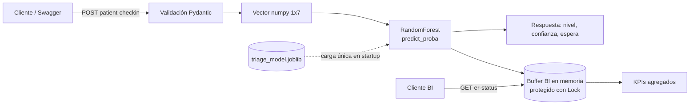

# Arquitectura y estado de construcción — TriageFlow ML-Engine

Documento técnico del proyecto. Describe cómo está construido el servicio, por qué se tomaron las decisiones principales y qué está verificado y qué falta por verificar.

## 1. Resumen

TriageFlow ML-Engine es un microservicio HTTP que recibe signos vitales de un paciente, los clasifica en un nivel de triaje (1 crítico, 2 urgente, 3 estable) con un `RandomForestClassifier` y mantiene en memoria un agregado de métricas de saturación de urgencias. Todo corre en un único contenedor Docker que expone el puerto 8000.

| Aspecto            | Detalle                                     |
| ------------------ | ------------------------------------------- |
| Lenguaje / runtime | Python 3.14                                 |
| Framework web      | FastAPI + Uvicorn (ASGI)                    |
| Machine Learning   | scikit-learn (RandomForest), NumPy, Joblib  |
| Validación         | Pydantic v2                                 |
| Contenerización    | Docker multi-stage sobre `python:3.14-slim` |
| Puerto             | 8000                                        |
| Estado             | En memoria del proceso (sin base de datos)  |

## 2. Diagrama



## 3. Estructura del repositorio

```
triageflow-ml-service/
├── app/
│   ├── main.py                # API FastAPI, inferencia y agregador BI
│   └── triage_model.joblib    # Modelo entrenado (se copia a la imagen)
├── ml/
│   └── train_model.py         # Entrenamiento offline (no viaja en la imagen)
├── tests/
│   └── test_api.py            # Pruebas de los endpoints
├── docs/
│   └── architecture.md        # Este documento
├── Dockerfile                 # Build multi-stage
├── .dockerignore
├── requirements.txt           # Dependencias con versiones fijas
└── README.md
```

## 4. Componentes, en el orden en que se construyeron

### 4.1 Modelo de ML (`ml/train_model.py`)

Es lo primero porque la API depende del artefacto `.joblib`.

**Contrato de características.** El vector de entrada tiene 7 dimensiones en este orden fijo: `age, heart_rate, systolic_bp, diastolic_bp, spo2, temperature, pain_level`. El orden se guarda dentro del propio `.joblib` (`{"model": ..., "features": [...]}`) y `main.py` debe respetarlo al armar el vector.

**Simulación de datos.** Se generan 6.000 pacientes a partir de una variable latente de gravedad (distribución beta) de la que derivan los signos vitales. A mayor gravedad: más edad, pulso más alto, SpO2 más baja, más fiebre y más dolor. Esto produce correlaciones realistas entre variables.

**Etiquetado.** Un puntaje clínico simplificado suma puntos por SpO2 baja, taquicardia o bradicardia, presión sistólica extrema, diastólica alta, fiebre o hipotermia, dolor alto y edad mayor de 65, más ruido gaussiano. Puntaje ≥ 4.5 es nivel 1, ≥ 2.0 es nivel 2 y menor es nivel 3. El ruido evita que el modelo se limite a memorizar umbrales exactos.

**Entrenamiento.**

| Parámetro          | Valor                                          |
| ------------------ | ---------------------------------------------- |
| Algoritmo          | `RandomForestClassifier`                       |
| Árboles            | 150                                            |
| Profundidad máxima | 10                                             |
| `min_samples_leaf` | 3                                              |
| `class_weight`     | `balanced`                                     |
| Partición          | 80/20 estratificada, semilla 42                |
| Artefacto          | `app/triage_model.joblib`, comprimido, ~1,9 MB |

**Resultado en el conjunto de prueba (datos simulados):** accuracy ≈ 0.89; F1 de 0.91 (nivel 1), 0.83 (nivel 2) y 0.92 (nivel 3).

> Estas métricas miden qué tan bien el modelo reproduce las reglas con las que se etiquetaron los datos sintéticos. No son una medida de desempeño clínico.

### 4.2 API (`app/main.py`)

**Ciclo de vida.** El modelo se carga una sola vez en el `lifespan` de FastAPI, al arrancar el contenedor, y no en cada petición. Si la carga falla, el servicio arranca de todos modos: `/health` informa `model_loaded: false` y el endpoint de inferencia responde `503`. La ruta del modelo se puede cambiar con la variable de entorno `MODEL_PATH`.

**Validación de entrada.** El esquema `PatientCheckin` impone rangos plausibles a cada campo (por ejemplo, `spo2` entre 50 y 100, `pain_level` entre 0 y 10). Un valor fuera de rango devuelve `422` sin llegar al modelo.

**Endpoints.**

| Método | Ruta                             | Función                                         |
| ------ | -------------------------------- | ----------------------------------------------- |
| GET    | `/health`                        | Estado del servicio, `model_loaded` y timestamp |
| POST   | `/api/v1/events/patient-checkin` | Inferencia de triaje y registro del evento      |
| GET    | `/api/v1/bi/er-status`           | KPIs agregados de urgencias                     |

**Flujo de `patient-checkin`.**

1. Pydantic valida el JSON.
2. Se arma el vector numpy de forma `(1, 7)` en el orden del contrato.
3. `predict_proba` devuelve las probabilidades por clase; se toma la clase con mayor probabilidad como `triage_level` y esa probabilidad (en porcentaje, 2 decimales) como `model_confidence`.
4. La espera estimada se asigna por nivel: 0, 15 y 45 minutos para los niveles 1, 2 y 3.
5. El evento se agrega al buffer BI y se responde con `status: TRIAGED_BY_ML`.

**Agregador BI.** El buffer es una lista en memoria protegida por un `threading.Lock`, porque el servidor puede atender peticiones concurrentes. Tiene un tope configurable (`MAX_EVENTS`, 10.000 por defecto): al superarlo se descartan los eventos más antiguos para que la memoria no crezca sin límite. `er-status` recalcula los KPIs en cada consulta (total de ingresos, porcentaje de críticos, confianza media, SpO2 promedio y desglose por nivel). Con el buffer vacío devuelve ceros.

### 4.3 Dependencias (`requirements.txt`)

Todas con versión exacta, las mismas con las que se entrenó y probó el modelo. Un `.joblib` de scikit-learn puede fallar o comportarse distinto si se carga con otra versión de la librería, por lo que fijar versiones es parte de la reproducibilidad.

### 4.4 Contenedor (`Dockerfile`, `.dockerignore`)

**Etapa 1, `builder`.** Parte de `python:3.14-slim`, instala las dependencias con `pip install --prefix=/install` y sin caché. Esta etapa se descarta al terminar.

**Etapa 2, `runtime`.** Parte de otra `python:3.14-slim` limpia y copia solo `/install` (las librerías ya instaladas) y la carpeta `app/`. No arrastra cachés ni herramientas de instalación.

**Decisiones de seguridad y operación.**

- El proceso corre con un usuario sin privilegios (`appuser`, UID 1001), no como root.
- `HEALTHCHECK` cada 30 s contra `/health` usando solo la librería estándar de Python, sin instalar `curl`. `docker ps` mostrará el estado `healthy`.
- `PYTHONUNBUFFERED=1` para que los logs salgan de inmediato por `docker logs`; `PYTHONDONTWRITEBYTECODE=1` para no generar `.pyc`.
- El comando de arranque es `uvicorn app.main:app --host 0.0.0.0 --port 8000`.

**`.dockerignore`.** Excluye `.git`, cachés, `tests/`, `docs/`, `ml/` y los `.md`. El script de entrenamiento no entra a la imagen; solo viaja el modelo ya entrenado, y eso sustenta el argumento de inmutabilidad del documento técnico del laboratorio.

### 4.5 Pruebas (`tests/test_api.py`)

Dos pruebas con `TestClient`:

- **Flujo completo:** `/health` sano; BI en cero al inicio; un paciente crítico (el del ejemplo del spec) clasificado como nivel 1 con espera de 0 min; un paciente estable clasificado como nivel 3; BI final con 2 ingresos y 1 crítico.
- **Validación:** un payload con `spo2: 150` devuelve `422`.

## 5. Limitaciones

- **Datos simulados.** El modelo aprende de datos sintéticos etiquetados con reglas escritas por el autor. Es un proyecto académico y no sirve para decisiones médicas.
- **Estado en memoria.** Los KPIs viven en el proceso: se pierden al reiniciar el contenedor y no se comparten entre réplicas. Con varias tareas en ejecución, cada una tendría sus propias métricas.
- **Sin autenticación.** Los endpoints son públicos; adecuado para el laboratorio, no para producción.
- **Esperas fijas.** El tiempo de espera depende solo del nivel, no de la ocupación real de la sala.

## 6. Ruta de escalado en AWS

Pensada para el documento técnico del laboratorio; no está implementada.

1. **Imagen:** publicada en Amazon ECR (o Docker Hub).
2. **Cómputo:** servicio en **Amazon ECS con Fargate**, con varias tareas del mismo contenedor, y **Application Load Balancer** delante usando `/health` como health check.
3. **Ingesta:** eventos de admisión publicados en **Amazon EventBridge**, que invoca el endpoint `patient-checkin`.
4. **Estado compartido:** para que los KPIs sean consistentes entre réplicas, el buffer en memoria se reemplazaría por un almacén externo (por ejemplo DynamoDB o Redis), o los eventos se enviarían a un pipeline de datos.
5. **BI:** métricas exportadas a **Amazon QuickSight**.
6. **Escalado:** autoescalado de tareas Fargate según CPU o número de peticiones.
